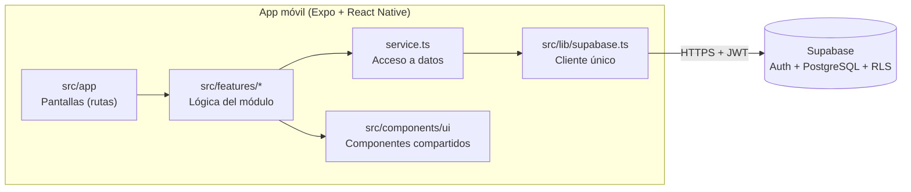

# Arquitectura

## Visión general

**Idea clave:** las pantallas no conocen a Supabase. Solo llaman a funciones de un `service.ts`.
Si mañana cambia la base de datos, solo se modifican los servicios.

## Capas y responsabilidades

| Capa | Carpeta | Qué contiene | Qué NO debe contener |
|---|---|---|---|
| Rutas | `src/app/` | Una pantalla = un archivo. Delgadas. | Lógica de negocio, consultas |
| Módulos | `src/features/<x>/` | Pantallas, hooks y servicio del módulo | Componentes genéricos |
| UI compartida | `src/components/ui/` | Botones, campos, tarjetas (catálogo en `docs/components.md`) | Conocimiento de finanzas ni llamadas a Supabase |
| Utilidades | `src/lib/` | Formatos, fechas, validaciones, cliente Supabase | Pantallas |
| Tipos | `src/types/` | Tipos de la base de datos | Lógica |

## Navegación y protección de rutas

`src/app/_layout.tsx` consulta la sesión (`AuthProvider`) y usa `Stack.Protected`:

- **Sin sesión** → solo existe el grupo `(auth)`: login, registro, recuperar contraseña.
- **Con sesión** → solo existe el grupo `(app)`: Dashboard y módulos.

Los paréntesis `(auth)` y `(app)` son *grupos de rutas*: organizan archivos sin aparecer en la URL.

## Flujo de un dato (ejemplo: listar gastos)

1. `src/app/(app)/expenses.tsx` renderiza la pantalla del módulo.
2. La pantalla llama a `listTransactions({ tipo: 'gasto' })` de `features/transactions/service.ts`.
3. El servicio usa el cliente de `src/lib/supabase.ts` y consulta la tabla `movimientos`.
4. Supabase aplica **RLS**: solo devuelve filas del usuario autenticado.
5. La pantalla muestra montos con `formatCurrency` y fechas con `formatDate`.

## Reglas de negocio con código compartido

| Regla | Dónde vive |
|---|---|
| RN-02 monto > 0 | `lib/validators.ts` (formulario) + `check` en SQL |
| RN-09 / RN-10 siguiente fecha recurrente | `lib/dates.ts` → `addInterval` (con pruebas unitarias) |
| Anti-duplicados al confirmar | Índice único en SQL |
| RN-14 aislamiento entre usuarios | RLS en SQL |

## Pruebas

- `npm test` ejecuta pruebas unitarias (Jest) de la lógica pura: `src/lib/__tests__/`.
- `npm run check` ejecuta tipos + linter + pruebas, igual que la integración continua.
- Las pruebas funcionales de pantallas (Integrante 4) se documentan en `docs/testing.md`.

## Decisiones técnicas

| Decisión | Alternativa descartada | Motivo |
|---|---|---|
| Expo Router | React Navigation manual | Rutas por archivos, menos configuración, protección de rutas integrada |
| Supabase | Backend propio | Auth + base + RLS listos; el proyecto se centra en la app |
| Servicios por módulo | Consultas dentro de pantallas | Un solo lugar para cambiar datos; facilita trabajar en paralelo |
| Fechas como texto `YYYY-MM-DD` | Objetos `Date` | Evita errores de zona horaria en fechas sin hora |
| `numeric` en SQL | `float` | Sin errores de redondeo con dinero |
