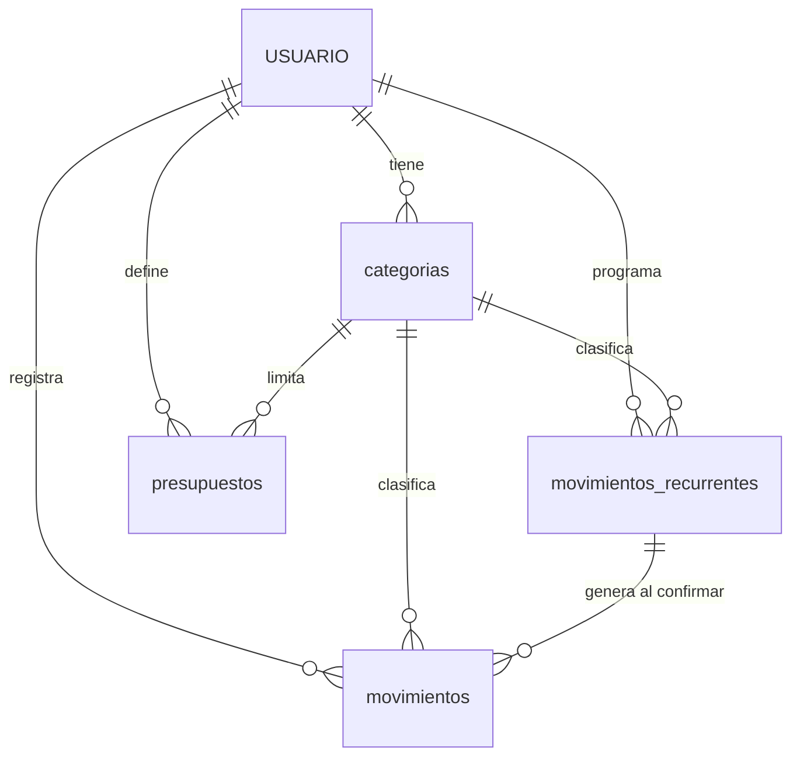

# Base de datos

El esquema completo está en [`supabase/migrations/0001_init.sql`](../supabase/migrations/0001_init.sql). Todo está en **español** (tablas, columnas y valores) y el propio script explica cada elemento con comentarios, además de dejar una descripción guardada en la base (`COMMENT ON`) que se ve en el panel de Supabase.
Este documento resume **qué hace y por qué**, para poder defenderlo en la presentación.

## Estado

La base del equipo ya está creada en Supabase (la configuró el Integrante 1, que además probó el registro, el aislamiento entre dos cuentas y el dinero disponible). **Los demás integrantes no deben ejecutar los scripts sobre la base compartida.**

## Migraciones

| Archivo | Qué hace |
|---|---|
| `0001_init.sql` | Crea todo el esquema. Ejecutar una sola vez en un proyecto vacío |
| `0003_dinero_disponible.sql` | Crea la función `dinero_disponible()` (RF-06). Ejecutar después de `0001` |
| `0002_iconos_a_claves.sql` | **Solo si ya ejecutaste un `0001` antiguo** con emojis: los convierte en claves. Es seguro ejecutarlo de todos modos |
| `0004_resolver_gasto_recurrente.sql` | Añade la RPC transaccional para confirmar u omitir gastos recurrentes. Aplicar después de `0001` |

## Cómo aplicarlo

1. Crea un proyecto en [supabase.com](https://supabase.com).
2. Abre **SQL Editor** → *New query*, pega el contenido de `0001_init.sql` y ejecútalo (*Run*).
3. Copia la URL y la *anon key* (Project Settings → API) a tu archivo `.env`.
4. Verifica en **Table Editor** que existen las cuatro tablas y que cada una muestra su descripción.
5. Si el script falla a la mitad, usa el bloque **REINICIO** del final del archivo y vuelve a ejecutarlo.

Cuando cambie el esquema, se pueden regenerar los tipos de TypeScript:

```bash
npx supabase gen types typescript --project-id <ID_DEL_PROYECTO> > src/types/database.ts
```

> Para desarrollar sin esperar confirmaciones por correo: Authentication → Providers → Email → desactivar *Confirm email*.

## Las cuatro tablas

| Tabla | Qué guarda | Equivalente en el documento de requerimientos |
|---|---|---|
| `categorias` | Categorías para clasificar (Alimentación, Salario…). Cada usuario tiene las suyas | `categories` |
| `movimientos` | Ingresos y gastos que **realmente ocurrieron** | `transactions` |
| `movimientos_recurrentes` | Programaciones que se repiten (renta, sueldo…) | `recurring_schedules` |
| `presupuestos` | Límites de gasto mensuales (general y por categoría) | `budgets` |

## Diccionario de columnas (inglés del documento → español)

| Tabla | Columnas |
|---|---|
| `categorias` | `id`, `usuario_id` (user_id), `nombre` (name), `tipo` (type), `icono` (icon: **clave**, no emoji) |
| `movimientos` | `id`, `usuario_id`, `categoria_id`, `tipo`, `monto` (amount), `fecha` (occurred_at), `descripcion`, `establecimiento` (merchant), `origen` (source), `movimiento_recurrente_id` (recurring_schedule_id), `fecha_programada` (scheduled_date), `creado_en`, `actualizado_en` |
| `movimientos_recurrentes` | `id`, `usuario_id`, `categoria_id`, `tipo`, `monto_esperado` (expected_amount), `frecuencia` (frequency), `fecha_inicio` (start_date), `proxima_fecha` (next_due_date), `descripcion`, `activo` (is_active), `creado_en`, `actualizado_en` |
| `presupuestos` | `id`, `usuario_id`, `categoria_id` (vacío = general), `monto_limite` (amount_limit), `mes` (period_month), `creado_en` |

| Valores | Español |
|---|---|
| `tipo` | `ingreso`, `gasto` (income, expense) |
| `origen` | `manual`, `recurrente`, `ia` (manual, recurring, ai) |
| `frecuencia` | `semanal`, `quincenal`, `mensual` (weekly, biweekly, monthly) |

## Diagrama de relaciones



`USUARIO` es la tabla `auth.users` que administra Supabase Auth.

## Elementos que crea el script

| Elemento | Qué es | Para qué sirve |
|---|---|---|
| `actualizar_actualizado_en()` | Función | Escribe la fecha y hora en `actualizado_en` cada vez que se edita una fila |
| 4 tablas | Estructuras de datos | Ver arriba |
| Índice `movimientos_una_vez_por_ocurrencia` | Índice único | Impide confirmar dos veces la misma ocurrencia de un recurrente |
| Índices `movimientos_usuario_*` | Índices de velocidad | Aceleran los listados y reportes |
| Índices `presupuestos_*_por_mes` | Índices únicos | Un presupuesto general y uno por categoría por mes |
| 4 políticas RLS | Seguridad | Cada usuario solo ve y modifica sus filas |
| `crear_categorias_iniciales()` + disparador `al_crear_usuario` | Función + disparador | Da 12 categorías a cada usuario que se registra |
| `COMMENT ON` | Descripciones | Documentan cada tabla y columna dentro de la base |

## Decisiones de diseño

| Decisión | Por qué |
|---|---|
| `icono` guarda una clave, no un emoji | Los emojis se ven distinto en cada dispositivo y no se pueden tematizar. La app traduce la clave a un ícono vectorial (`iconCatalog.ts`); cambiar de librería no toca los datos |
| Nombres en español | Todo el equipo entiende la base de datos sin traducir. Los nombres de funciones y componentes del código siguen en inglés |
| `usuario_id` con `default auth.uid()` | El cliente no necesita enviar su propio id, así no puede "falsificarlo" |
| **RLS** con una política por tabla | Aunque alguien conozca la API, solo ve sus filas (RN-01, RN-14). El aislamiento no depende del código de la app |
| `check (monto > 0)` | RN-02 también se exige en la base, no solo en el formulario |
| Llave foránea compuesta `(categoria_id, usuario_id, tipo)` | Impide usar la categoría de otro usuario o poner un gasto en una categoría de ingresos |
| Índice único `(movimiento_recurrente_id, fecha_programada)` | Evita duplicar la misma ocurrencia aunque el usuario toque "confirmar" dos veces |
| `check (origen <> 'recurrente' or ...)` | Un movimiento de origen recurrente siempre dice de qué programación viene |
| Presupuesto: `mes` siempre día 1 + dos índices únicos | Un presupuesto general y uno por categoría por mes; `NULL` no se compara bien en `unique`, por eso son dos índices parciales |
| `numeric(12,2)` y no `float` | Los `float` acumulan errores de redondeo con dinero |
| Movimientos sin `on delete cascade` hacia categorías | No se puede borrar una categoría que ya tiene movimientos. Al borrar un usuario se elimina todo en cascada |
| Totales y saldo **no se guardan** | Se calculan desde `movimientos`, así nunca quedan desactualizados |

## Pendiente (a coordinar con el Integrante 1)

- Aplicar `0004_resolver_gasto_recurrente.sql` a la base compartida y comprobar sus permisos y comportamiento con dos sesiones. La RPC usa las políticas RLS existentes; no cambia tablas ni políticas.
- Un presupuesto por categoría debería apuntar solo a categorías de tipo `gasto`; hoy solo lo valida la app.
