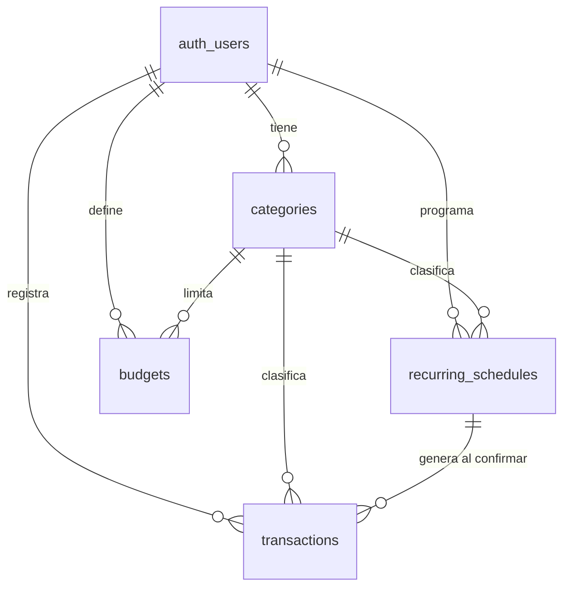

# Base de datos

El esquema completo está en [`supabase/migrations/0001_init.sql`](../supabase/migrations/0001_init.sql).
Este documento explica **qué hace y por qué**, para poder defenderlo en la presentación.

## Cómo aplicarlo

1. Crea un proyecto en [supabase.com](https://supabase.com).
2. Abre **SQL Editor**, pega el contenido de `0001_init.sql` y ejecútalo.
3. Copia la URL y la *anon key* (Project Settings → API) a tu archivo `.env`.
4. Regenera los tipos de TypeScript cuando cambie el esquema:

   ```bash
   npx supabase gen types typescript --project-id <ID_DEL_PROYECTO> > src/types/database.ts
   ```

> Para desarrollar sin esperar confirmaciones por correo: Authentication → Providers → Email → desactivar *Confirm email*.

## Diagrama de relaciones



## Decisiones de diseño

| Decisión | Por qué |
|---|---|
| `user_id` con `default auth.uid()` | El cliente no necesita enviar su propio id, así no puede "falsificarlo". |
| **RLS** con una política por tabla | Aunque alguien conozca la API, solo ve sus filas (RN-01, RN-14). El aislamiento no depende del código de la app. |
| `check (amount > 0)` | RN-02 también se exige en la base, no solo en el formulario. |
| Llave foránea compuesta `(category_id, user_id, type)` | Impide usar la categoría de otro usuario o poner un gasto en una categoría de ingresos. |
| Índice único `(recurring_schedule_id, scheduled_date)` | Evita duplicar la misma ocurrencia de un recurrente aunque el usuario toque "confirmar" dos veces. |
| `check (source <> 'recurring' or ...)` | Un movimiento de origen recurrente siempre dice de qué programación viene. |
| Presupuesto: `period_month` siempre día 1 + dos índices únicos | Un presupuesto general y uno por categoría por mes; `NULL` no se compara bien en `unique`, por eso son dos índices parciales. |
| `numeric(12,2)` y no `float` | Los `float` acumulan errores de redondeo con dinero. |
| Categorías sin `on delete cascade` desde movimientos | No se puede borrar una categoría que ya tiene movimientos (la base lo impide). Al borrar un usuario se elimina todo en cascada. |
| Trigger al crear usuario | Cada usuario nuevo recibe 12 categorías iniciales sin hacer nada. |
| Totales y saldo **no se guardan** | Se calculan desde `transactions`, así nunca quedan desactualizados. |

## Pendiente (a coordinar con el Integrante 3)

- La confirmación/omisión de recurrentes puede implementarse en el cliente (insertar la transacción y actualizar `next_due_date`) o como función SQL (RPC) para que sea atómica. Si se hace en el cliente, la restricción única ya protege contra duplicados, pero un fallo entre los dos pasos dejaría la fecha sin avanzar.
- Este SQL no se pudo ejecutar contra un PostgreSQL real durante la preparación del proyecto: **probarlo en un proyecto Supabase nuevo y corregir lo que falle.**
- Un presupuesto por categoría debería apuntar solo a categorías de tipo `expense`; hoy solo lo valida la app.
